# Quản lý thu chi

Một cuốn sổ thu chi, nhưng ở trên web.

Đây là đồ án môn Phân tích thiết kế hướng đối tượng của nhóm mình, đề tài "Phân tích và thiết kế hệ thống quản lý thu chi cá nhân và lập kế hoạch tài chính". Tài liệu phân tích, sơ đồ use case và sơ đồ lớp nằm trong `docs/`. Repo này là bản website chạy được để demo.

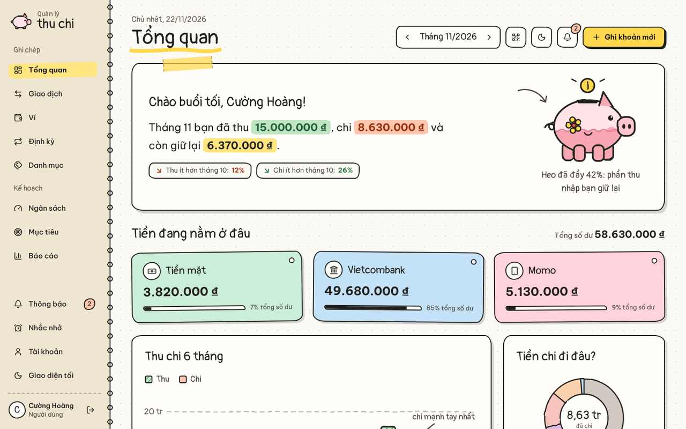

## Hệ thống gồm những gì

Hệ thống giúp một người theo dõi tiền của mình: tiền vào, tiền ra, đang nằm ở ví nào, tháng này có tiêu quá tay không, để dành cho mục tiêu tới đâu rồi.

Có bốn loại người dùng:

- **Người dùng**: ghi chép thu chi, quản lý ví, đặt ngân sách, đặt mục tiêu tiết kiệm, xem báo cáo.
- **Quản trị viên**: khóa hoặc mở tài khoản, quản lý danh mục mặc định, xem thống kê toàn hệ thống.
- **Nhân viên hỗ trợ**: tìm người dùng, gửi thông báo hỗ trợ.
- **Kiểm toán viên**: chỉ xem số liệu thống kê, không sửa được gì.

Về kỹ thuật, mọi thứ chạy trong một chương trình Node.js:

- **Giao diện** viết bằng HTML, CSS, JavaScript thuần, không dùng framework, không cần build. Trình duyệt gọi API để lấy dữ liệu.
- **REST API** viết bằng Express. Đăng nhập bằng JWT, mỗi API kiểm tra vai trò trước khi cho làm.
- **Cơ sở dữ liệu** là SQLite, dùng mô-đun `node:sqlite` có sẵn trong Node, dữ liệu nằm trong một file. Thao tác nào nhiều bước (như chuyển tiền giữa hai ví) đều chạy trong một transaction.
- **Mô hình miền** gồm 17 lớp, đặt tên đúng như sơ đồ lớp trong tài liệu thiết kế. Các quy tắc nghiệp vụ R1 đến R12 nằm ở tầng này.
- **Việc chạy ngầm**: một bộ hẹn giờ trong server tự ghi các khoản định kỳ, gửi nhắc nhở và lập phiếu tổng kết cuối tháng.
- **Quét hóa đơn**: ảnh hóa đơn được gửi cho Gemini để đọc ra số tiền và món hàng. Không có API key thì dùng bản giả trả dữ liệu mẫu.

## Chạy trên máy

Cần **Node.js 22.13 trở lên**. Không cần cài SQL Server hay MySQL.

```bash
git clone https://github.com/cuong-learn-ds/quan-ly-thu-chi.git
cd quan-ly-thu-chi
npm run setup    # lần đầu, để cài thư viện
npm start
```

Trên Windows mà PowerShell chặn lệnh `npm`, gõ `npm.cmd` thay cho `npm`.

Mở **http://localhost:5080**. Lần chạy đầu app tự tạo cơ sở dữ liệu ở `server/data/` và nạp sẵn dữ liệu mẫu để có cái mà xem. Tài khoản có sẵn, mật khẩu đều là `Demo@123`:

| Vai trò | Email |
|---|---|
| Người dùng | `demo@demo.vn` |
| Quản trị viên | `admin@demo.vn` |
| Nhân viên hỗ trợ | `hotro@demo.vn` |
| Kiểm toán viên | `kiemtoan@demo.vn` |

Muốn làm lại từ đầu thì xóa thư mục `server/data` rồi chạy lại.

Nếu web báo "Không kết nối được máy chủ", kiểm tra là đang mở đúng `http://localhost:5080`, không phải mở thẳng file `index.html`. Cửa sổ đang chạy `npm start` cũng phải còn mở.

Kiểm thử tự động: `npm test` (46 bài, kiểm các quy tắc R1 đến R12 và các luồng API chính).

## Triển khai

Bọn mình mới chạy demo trên máy cá nhân. Phần dưới là cách làm gợi ý nếu muốn đưa lên cho người khác dùng.

### Cấu hình

Đặt bằng biến môi trường, không ghi vào code:

| Biến | Dùng để | Mặc định |
|---|---|---|
| `PORT` | cổng chạy | `5080` |
| `JWT_KEY` | khóa ký token đăng nhập, **bắt buộc đổi** khi đưa lên mạng | khóa mẫu |
| `DB_FILE` | đường dẫn file cơ sở dữ liệu | `server/data/quan-ly-thu-chi.db` |
| `GEMINI_API_KEY` | bật quét hóa đơn thật | không có, dùng bản giả |
| `GEMINI_MODEL` | model Gemini | `gemini-2.5-flash` |

Ví dụ trên Windows PowerShell:

```powershell
$env:JWT_KEY = "mot-chuoi-dai-va-kho-doan"
$env:GEMINI_API_KEY = "key-cua-ban"
npm.cmd start
```

### Demo trong lớp (cùng mạng Wi-Fi)

Chạy server trên laptop như bình thường. Trên web bấm nút mã QR ở đầu trang, rồi dùng điện thoại cùng Wi-Fi quét là mở được. Nếu điện thoại không vào được, cho phép Node.js đi qua tường lửa Windows (Windows thường hỏi ở lần chạy đầu).

### Đưa lên máy chủ (VPS Linux)

1. Cài Node.js 22.13 trở lên, clone repo, chạy `npm run setup`.
2. Đặt `JWT_KEY` và các biến cần thiết.
3. Cho server chạy nền và tự bật lại khi máy khởi động lại, ví dụ dùng pm2:
   ```bash
   npm install -g pm2
   pm2 start "npm start" --name thu-chi
   pm2 save && pm2 startup
   ```
4. Đặt Nginx phía trước để có tên miền và HTTPS (Let's Encrypt), chuyển tiếp về `http://127.0.0.1:5080`.
5. Sao lưu định kỳ file trong `server/data/`, vì toàn bộ dữ liệu nằm ở đó.

Vì dùng SQLite nên chỉ chạy một server. Muốn chạy nhiều server cùng lúc thì phải đổi sang cơ sở dữ liệu khác.

## Các chức năng

### Đăng nhập

Trang đầu tiên làm giống bìa một cuốn sổ. Có sẵn tài khoản dùng thử để vào xem nhanh.

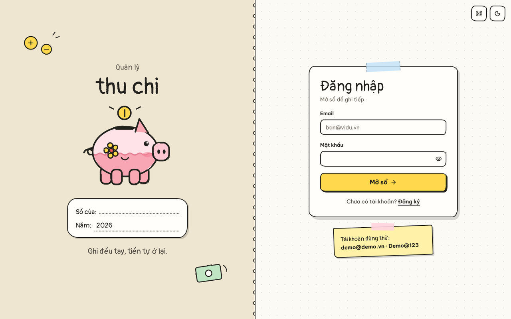

### Tổng quan

Vào là thấy ngay tháng này thu bao nhiêu, chi bao nhiêu, giữ lại bao nhiêu, viết thành một câu chứ không phải bốn ô số. Con heo đất đầy theo phần trăm thu nhập giữ lại được. Bên dưới có số dư từng ví, biểu đồ thu chi 6 tháng, tiền chi theo danh mục, các hũ ngân sách và vài ghi chú nhanh như "cứ đà này cả tháng sẽ chi khoảng 7,3 triệu".


### Giao dịch

Trình bày như một trang sổ có lề đỏ: ngày ghi ở lề, cuối mỗi ngày có dòng cộng. Tìm theo ghi chú, lọc theo loại, ví, danh mục, khoảng ngày, xuất ra Excel. Màn hình rộng có sẵn ô ghi nhanh bên phải.

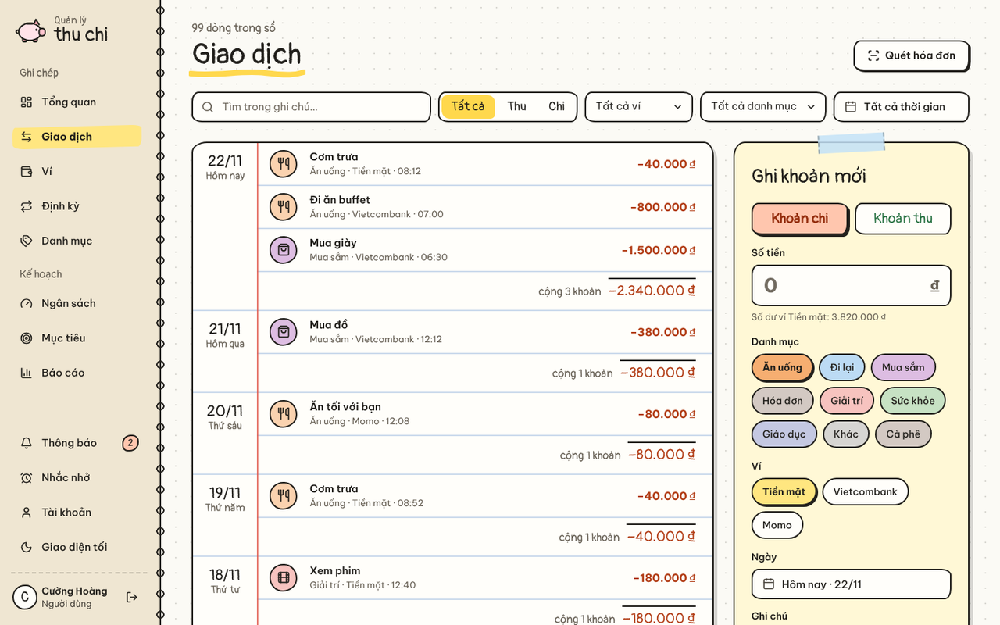

### Quét hóa đơn

Kéo thả, dán hoặc chụp ảnh hóa đơn. Hệ thống đọc ra số tiền và các món hàng rồi tạo một khoản chi nháp để mình xem lại trước khi lưu.

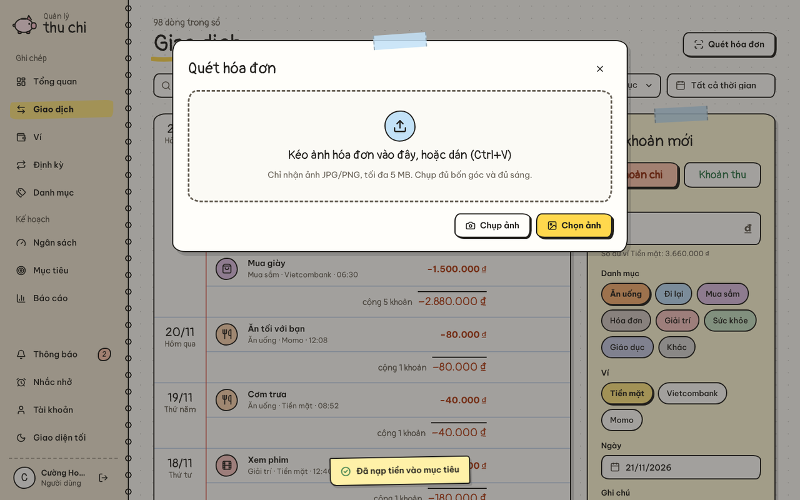

### Ví

Tiền mặt, tài khoản ngân hàng, ví điện tử. Chuyển tiền giữa các ví có lưu lịch sử và không bị tính là thu hay chi.

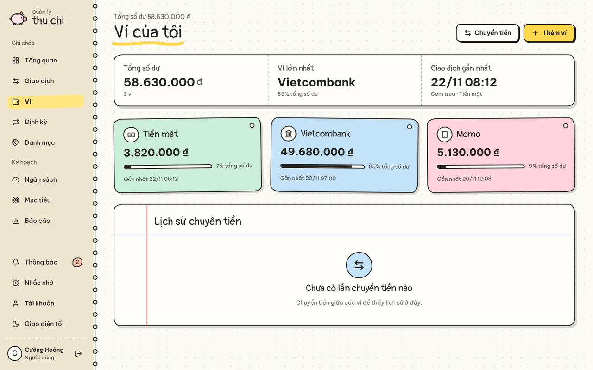

### Giao dịch định kỳ

Mấy khoản tháng nào cũng có như lương, tiền nhà thì khai một lần. Đến ngày, hệ thống tự ghi vào sổ. Ví không đủ tiền thì tháng đó bỏ qua và báo cho mình biết.

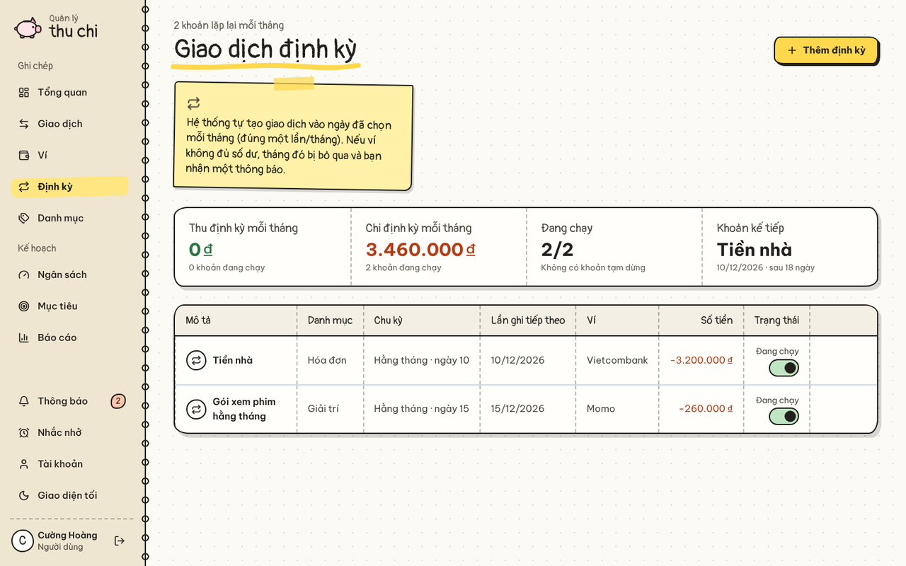

### Danh mục

Danh mục thu và chi riêng, mỗi danh mục có biểu tượng và màu. Danh mục nào nhiều tiền nhất được xếp lên đầu, kèm thanh tỷ lệ.

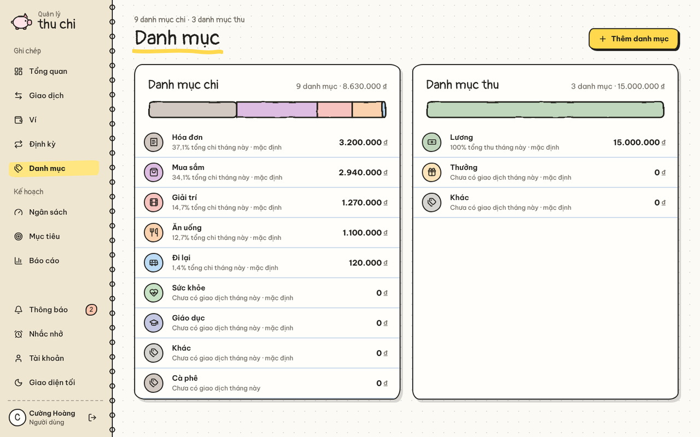

### Ngân sách

Mỗi danh mục là một cái hũ. Chi tới đâu nước dâng tới đó. Qua vạch cảnh báo thì có thông báo, vượt hạn mức thì hũ tràn và có dấu mộc đỏ. Bên dưới có bảng số liệu chi tiết.

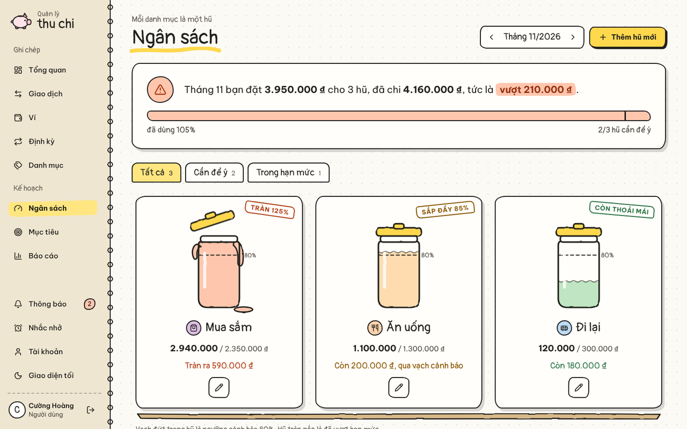

### Mục tiêu tiết kiệm

Mỗi mục tiêu là một con heo. Hệ thống tính sẵn mỗi tháng nên bỏ bao nhiêu để kịp hạn, báo khi đang chậm nhịp. Có nút bỏ ống nhanh +100.000, +500.000, +1.000.000.

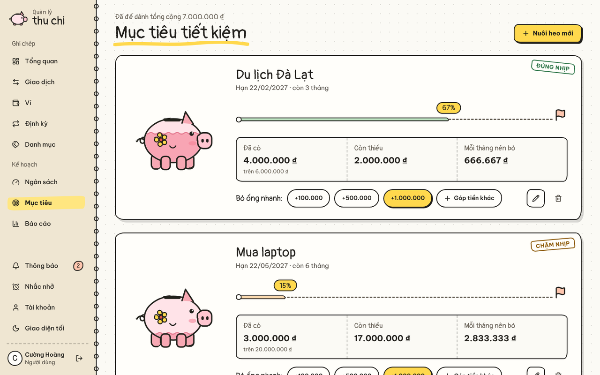

### Báo cáo

Xem theo tháng này, 3 tháng, 6 tháng hoặc cả năm. Có phiếu tổng kết, biểu đồ, chi theo danh mục và so sánh với tháng trước. In ra giấy hoặc xuất Excel được.

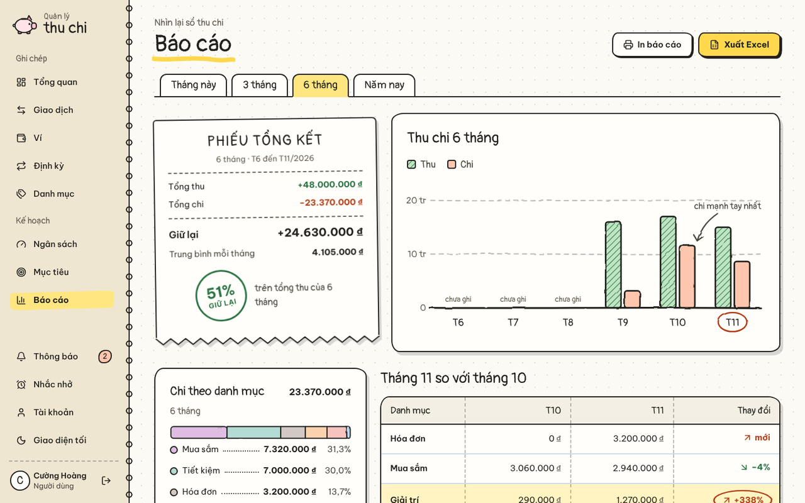

### Thông báo và nhắc nhở

Thông báo khi ngân sách sắp hết hoặc đã vượt, khi một khoản định kỳ không ghi được vì ví thiếu tiền. Phần nhắc nhở cho tự bật tắt từng loại: nhắc ghi chép mỗi ngày, cảnh báo ngân sách, nhắc góp tiền cho mục tiêu.

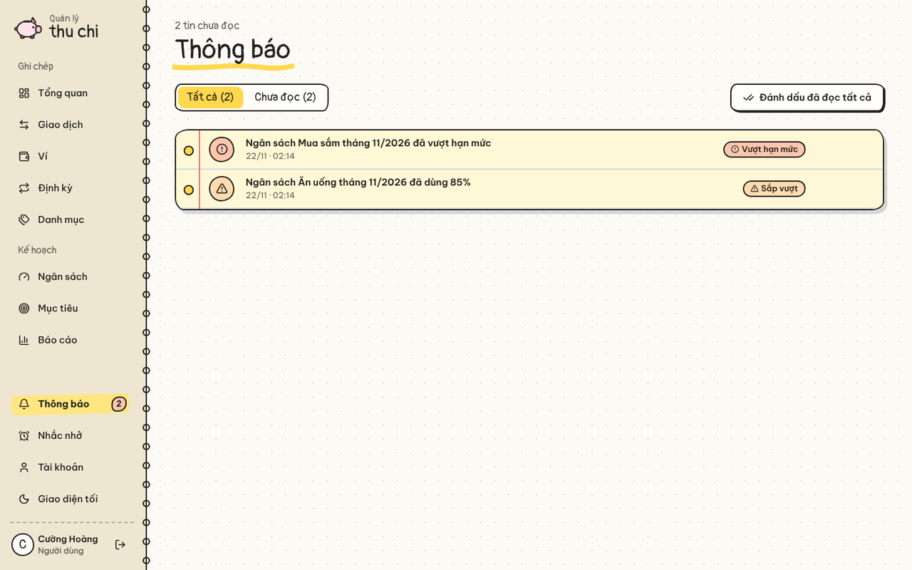

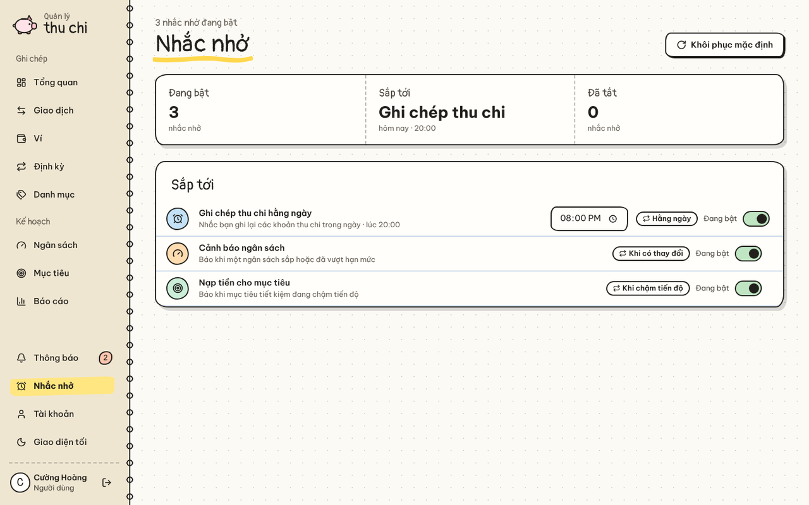

### Tài khoản

Sửa họ tên, đổi mật khẩu (có thanh đo độ mạnh), chọn giao diện sáng, tối hoặc theo máy.

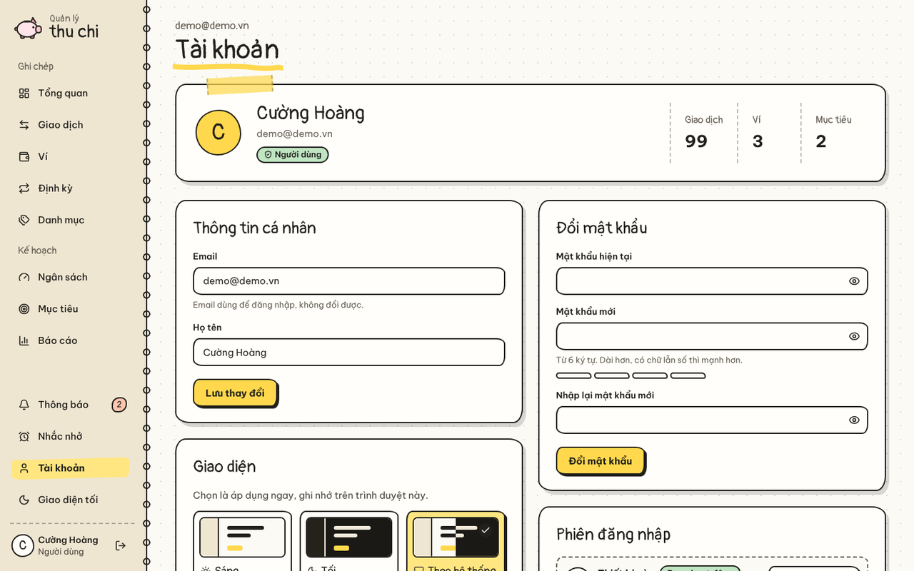

### Quản trị

Quản trị viên xem danh sách người dùng, khóa hoặc mở tài khoản, quản lý danh mục mặc định, xem thống kê và tổng kết. Nhân viên hỗ trợ và kiểm toán viên có màn hình riêng, gọn hơn.

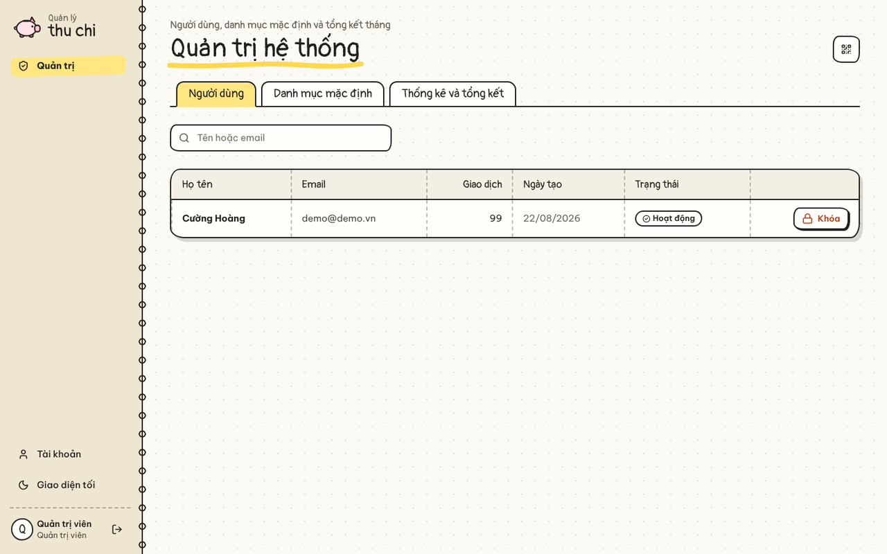

### Giao diện tối

Nền như giấy than, chữ màu kem, các màu vẫn đủ tương phản để dễ đọc.

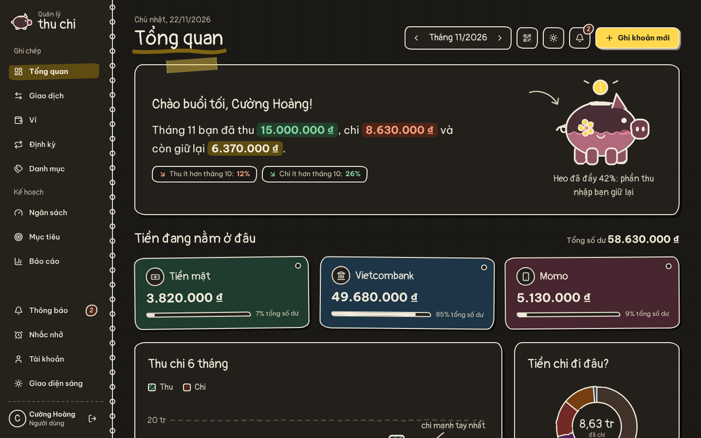

### Trên điện thoại

Thanh điều hướng nằm dưới, nút tròn ở giữa để ghi khoản mới, hộp thoại trượt lên từ dưới.

<p align="center">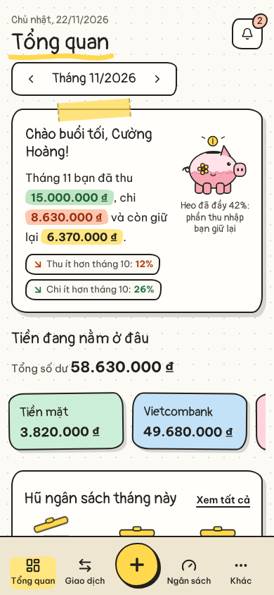</p>

## Cấu trúc thư mục

```
server/
  src/domain/     17 lớp và các kiểu liệt kê, theo sơ đồ lớp
  src/services/   xử lý nghiệp vụ, chia theo nhóm use case
  src/app.js      REST API, JWT, phân quyền
  src/jobs.js     việc chạy ngầm: định kỳ, nhắc nhở, tổng kết tháng
  src/seed.js     dữ liệu mẫu
  public/         giao diện
  test/           kiểm thử
docs/
  staruml/        sơ đồ use case, sơ đồ lớp
  thiet-ke/       tài liệu thiết kế
  anh/            ảnh chụp màn hình
```

Font chữ: Pangolin cho tiêu đề viết tay, Be Vietnam Pro cho nội dung. Icon lấy từ bộ Lucide.

## Còn thiếu gì

- Mới thử kỹ trên Chrome. Safari và Firefox chưa test.
- Quét hóa đơn thật cần API key Gemini, và đọc đúng hay không còn tùy ảnh chụp.
- Chưa thử triển khai thật trên VPS. Phần triển khai ở trên mới là hướng dẫn.
